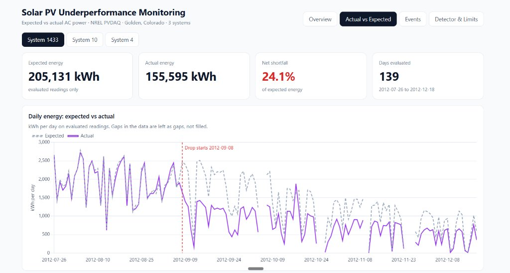

# Detecting Underperformance in Solar PV Systems and Estimating Lost Energy

An explainable monitoring workflow built on public field data from three real photovoltaic (PV) systems. For each system it answers one operational question:

> **How much AC power should this system produce under the sunlight and temperature it is actually experiencing, how far below that is it, and which sustained events should someone inspect first?**



---

## Key findings

| | Result |
|---|---|
| **Largest system (1433, 449 kW rooftop)** | An abrupt, lasting drop of **40.7%** below expected output starting **8 September 2012** and continuing to the end of the data (18 Dec 2012). About **48,300 kWh** lost over that period. In the 60 days before the drop, the shortfall was only **1.2%**. |
| **Small research arrays (Systems 4 and 10, ~1 kW each)** | Net shortfall of **4.0%** (System 4) and **4.9%** (System 10) of expected energy over their evaluation window (20 Aug to 1 Dec 2019). Events are strongly associated with cold weather (≤ 3 °C). |
| **Events detected** | **18** (System 4), **23** (System 10) and **80** (System 1433), each a run of at least 30 minutes below the expected range. |
| **Detector sensitivity** | Catches drops of about **7% or more** in Systems 4 and 10 (90% or higher detection rate). System 1433 needs about **50%** for single readings, so its lasting drop is measured with a daily comparison instead. |
| **Cause of the 1433 drop** | **Unknown.** The data cannot say. It needs confirmation from the site operator (see [Limitations](#limitations)). |

The workflow tells an operator **when and where to look**. It does not diagnose a root cause.

---

## Table of contents

1. [Business context](#business-context)
2. [Data](#data)
3. [Method](#method)
4. [Results](#results)
5. [How good is the detector?](#how-good-is-the-detector)
6. [How to read an alert](#how-to-read-an-alert)
7. [Limitations](#limitations)
8. [Mistakes I caught and fixed](#mistakes-i-caught-and-fixed)
9. [Repository structure and how to reproduce](#repository-structure-and-how-to-reproduce)
10. [Next steps](#next-steps)
11. [Data citation and license](#data-citation-and-license)

---

## Business context

Solar operators need to know when a system produces less than the weather should allow. A raw drop in production is not enough, because cloudy weather lowers output normally and a faulty sensor can create a misleading reading. This project builds a transparent comparison between **expected** and **actual** AC power so that real shortfalls can be separated from ordinary weather variation.

The output is a ranked list of inspection candidates, each with a start, end, duration, severity and estimated lost energy in kWh. Lost energy turns an abstract shortfall into a number a decision-maker can weigh against the cost of a site visit.

## Data

**Source:** NREL Photovoltaic Data Acquisition (PVDAQ) public datasets, hosted in the OEDI data lake. Three real systems at one site in Golden, Colorado (about 1,780 to 1,795 m elevation). Each has its own AC power meter, plane-of-array irradiance sensor, module temperature and ambient temperature, so expected power never depends on modeled satellite irradiance.

| System | Description | Capacity | Reading interval | Rows | Period kept |
|---|---|---|---|---|---|
| **1433** | NREL RSF1, commercial rooftop | 449.28 kW | 15 min | 68,780 | 2011-01-01 to 2012-12-19 |
| **4** | NREL x-Si-1, research array (crystalline silicon) | 1.00 kW | 1 min | 678,831 | 2018-01-01 to 2018-08-03 and 2019-03-20 to 2019-12-01 |
| **10** | NREL CIS-1, research array (thin film) | 1.12 kW | 1 min | 679,620 | same two windows as System 4 |

Total: **1,427,231 measurement rows**. Systems 4 and 10 sit side by side with the same tilt and azimuth, so they experience the same weather.

**Data quality handling**
- Missing values are **never filled or interpolated**. Rows with missing inputs are excluded at model time, and logging gaps are never bridged into event durations or energy totals.
- Derived flags (night offset, outlier power, over-capacity, daylight with missing power) are used for **filtering only**, never as model inputs or as proof of failure.
- Timestamps are local site time with no stored offset. Daylight saving was handled explicitly: the solar position for Systems 4 and 10 uses a fixed UTC−7 offset and System 1433 uses UTC−6. Both were verified by checking that the data's solar midpoint lines up with the computed one.
- The cleaned files end on **2019-12-01** (Systems 4 and 10), earlier than the 16 to 17 December dates in the metadata file, and on **2012-12-19** (System 1433).

## Method


### 1. Expected power model (one per system)

- **Model:** gradient boosting regression (`HistGradientBoostingRegressor`: learning rate 0.08, 200 iterations, 31 leaves, L2 regularization 0.5, fixed seed).
- **Inputs:** plane-of-array irradiance, module temperature, ambient temperature, **solar elevation** (computed with `pvlib`) and an **afternoon indicator** (solar azimuth above 180°). The last two let the model learn effects that depend on the sun's position.
- **Training data:** only normal-looking readings. Irradiance of at least 50 W/m², power above zero and not above nameplate capacity, flagged rows excluded, and **days that are abnormally low** (daily performance ratio below half of the system's own typical value) excluded so the model does not learn faults as normal behavior.
- **Chronological split, never random:** the first 60% of time is for training, the next 20% for calibration and the last 20% for testing. This avoids leakage between neighboring timestamps.

### 2. Shortfall and events

| Rule | Value | Why |
|---|---|---|
| Evaluation rows | irradiance of at least 150 W/m², expected power at least 20% of capacity, flagged rows excluded | an early trial at 50 W/m² produced many false alarms in dim, cloudy periods |
| Shortfall threshold | 95th percentile of the calibration-period shortfall, both in watts and as a share of expected power | taken from the residual spread of a healthy period, not guessed |
| Candidate interval | shortfall above both thresholds | |
| Event | consecutive candidates (gap no longer than the reading interval), **at least 30 minutes** long | filters short cloud-edge noise |

### 3. Lost energy

```
E_lost (kWh) = Σ max(P_expected − P_actual, 0) × Δt(hours) / 1000
```

Δt is the true reading interval (1/60 hour for Systems 4 and 10, 0.25 hour for System 1433). Missing intervals are not counted as lost.

### 4. Classifying events across the paired systems

For Systems 4 and 10, which share weather, each event is compared with the other system's behavior in the same window. If the other system also underperformed, the event is labeled `common_or_unclear`. Otherwise it is `system_X_specific`. The 0.6 cutoff on the other system's ratio is a judgment call, not a validated threshold.

## Results

All energy figures are computed on evaluated rows only (irradiance of at least 150 W/m², flagged rows excluded), so they are a **lower bound** on full-day energy. Each system has its own evaluation window, so **compare percentages, not kWh**.

### Summary by system

| System | Evaluation window | Expected (kWh) | Actual (kWh) | Net shortfall | Events | Lost energy in events (kWh) |
|---|---|---|---|---|---|---|
| **4** | 2019-08-20 to 2019-12-01 | 419.9 | 403.2 | **16.8 kWh (4.0%)** | 18 | 16.9 |
| **10** | 2019-08-20 to 2019-12-01 | 466.5 | 443.8 | **22.7 kWh (4.9%)** | 23 | 11.0 |
| **1433** | 2012-07-26 to 2012-12-18 | 204,689.2 | 155,644 | **49,045 kWh (24.0%)** | 80 | 9,235.8 |

### System 1433: a sudden, lasting drop

| Period | Expected (kWh) | Actual (kWh) | Shortfall |
|---|---|---|---|
| 60 days before 8 Sep 2012 | n/a | n/a | **1.2%** |
| 8 Sep 2012 to 18 Dec 2012 | 118,766 | 70,469 | **40.7% (48,297 kWh)** |

- The change is a **step, not a slope**: the daily ratio was about −3% on 7 September and about −42% on 8 September.
- The shortfall is a roughly constant share (about 40%) of expected output **at every irradiance level**.
- Per-reading events capture only about **19%** of the lasting loss (9,236 of 48,297 kWh), because the model's per-reading error bands are wide for this system (mean absolute error about 6.8% of capacity). The lasting-period figure is therefore the headline number.
- Candidate explanations consistent with a lasting step: part of the system not exporting power, or a change in how power is measured. A sensor over-reading irradiance looks less likely, because the module-to-ambient temperature difference did not fall as that would predict. None of these was tested, and the data cannot confirm any of them.

### Systems 4 and 10: cold weather and slow drift

- **Cold-weather association.** Weather at or below 3 °C made up only about 13% of evaluated rows, but **89% (System 4) and 97% (System 10)** of event rows fall in it (487 and 2,418 event rows). Per 1,000 evaluated rows, that is **67.6 event rows in cold weather versus 1.2 in warmer weather** for System 4 (about 57 times higher) and **351.5 versus 1.6** for System 10 (about 214 times higher). Some events show module temperatures close to the air temperature in freezing conditions, which is consistent with covered panels (snow or frost), but this is an **association, not a proven cause**. The rates are not comparable between the two systems, because each uses its own model and thresholds.
- **Most events are shared.** Of System 4's 18 events, 16 are `common_or_unclear` (15.5 of 16.9 kWh); of System 10's 23, 16 are (10.0 of 11.0 kWh). Few are specific to one system.
- **System 10 shows a slow drift** of roughly 1 to 3% per year (same-month comparison), a candidate for gradual degradation. It is unverified.

## How good is the detector?

There are no labeled faults in the data, so the detector was tested by **injecting artificial faults** into healthy, sunny midday windows (10:00 to 13:00, three hours long) on 30 randomly chosen days per level, then checking how many were detected. All thresholds were held fixed.

| Power drop injected | System 4 | System 10 | System 1433 |
|---|---|---|---|
| −2% | 0% | 0% | not tested |
| −3% | 0% | 10% | not tested |
| −5% | 23% | 67% | not tested |
| −7% | 90% | 97% | not tested |
| −10% | 100% | 100% | 0% |
| −20% | 100% | 100% | 0% |
| −30% | not tested | not tested | 3% |
| −40% | not tested | not tested | 17% |
| −50% | not tested | not tested | 100% |
| −70% | not tested | not tested | 100% |
| Zero output | 100% | 100% | 100% |

- Systems 4 and 10 reliably catch drops of about **7% or more**.
- System 1433 needs about **50%** to be caught reading by reading, which is why its lasting 40% step is measured with the daily comparison instead.
- With 30 trials per cell, each rate is accurate to roughly ±10 percentage points.
- This is a **best case**: sunny middays, where the model is most accurate. Weak-light and cloudy periods were not injected.
- In unmodified data the detector raised no alerts in the healthy part of System 1433's test window (before 8 Sep 2012).

**Model accuracy.** On System 4, a first version of the gradient boosting model beat the simple baseline `P = k × G` on later data (mean absolute error 25.4 W, or 2.5% of capacity, versus 33.2 W, or 3.3%; RMSE 70.6 W versus 89.2 W). The model was later refined (solar-position inputs, exclusion of abnormal low days) and trained separately for each system.

## How to read an alert

| What the data shows | Reasonable reading | What would confirm it |
|---|---|---|
| Normal irradiance and temperature, persistent shortfall | Unexplained underperformance: possible soiling, shading, inverter, wiring or sensor issue | Site inspection, inverter logs, maintenance records |
| Shortfall in freezing conditions, panel temperature near air temperature | Possible snow or frost cover | Weather records, site photos |
| Sudden step down that stays | Part of the system offline, or a measurement or sensor change | Maintenance log, comparison with a clear-sky model |
| Output near zero while expected power is positive, sustained | Candidate output interruption (not proof the system stopped) | Inverter logs |
| Gradual decline over a year | Possible degradation or soiling | Cleaning records, rain data |

## Limitations

- **System level only.** There are no panel- or string-level readings, so results identify a system and a period, not a component.
- **No ground truth.** There are no maintenance logs, cleaning records, fault codes or rain data, so no root cause is proven and soiling cannot be measured.
- **Lost energy is an estimate.** It is the gap between measured output and the model's expectation of normal operation, not a utility-meter loss. It depends on the model: for System 4, two model variants gave **2.9 kWh** and **16.9 kWh** of event-level loss, so treat single numbers as indicative.
- **Short evaluation windows.** Events are computed on the last roughly 3 to 5 months of each system, not on its full history.
- **Uneven training coverage.** Systems 4 and 10 have no data between August 2018 and March 2019 (long logging gaps), so winter behavior is learned from less data.
- **Wide bands for System 1433.** Per-reading error is large, so single events are weak evidence and the lasting-period measure should be used.
- **System 1433 power unit.** Raw values appear to be in kilowatts (maximum about 388 against a 449.28 kW capacity) and were scaled to watts during cleaning. The original unit should be confirmed in the PVDAQ metadata.
- **Detector test is a best case** (sunny middays only), and the cold-weather link is an association.
- **One site, historical periods.** The results are not claimed to apply to other climates, such as the Gulf region, or to current commercial fleets.

## Mistakes I caught and fixed

1. **Wrong timezone for System 1433.** I first assumed UTC−7 for every system. Checking where the data's solar midpoint fell against the computed one showed a one-hour shift for System 1433. The correct offset is UTC−6, and the model was retrained.
2. **A comparison that was always false.** A plotting cell compared a date with a timestamp, so it highlighted nothing. After fixing it, the plot revealed 37 flagged points in 10 groups.
3. **Over-broad training exclusions.** Excluding every low-output day made the model look worse on the full test. Separating the test into system-specific and common days showed the exclusion was right once evaluated on clean data.
4. **Overstated labels.** An event was first called "system specific" because the other system looked healthy. Rechecking showed the other system was also well below normal, so the label was made stricter and the cutoff is documented as a judgment call.

## Repository structure and how to reproduce

```
solar-performance-monitoring/
├── README.md
├── docs/
│   └── DATA_DICTIONARY.md          column meanings, cleaning rules, data gaps
├── notebooks/
│   └── solar_panels.ipynb          full workflow: model, events, energy, exports
├── models/
│   ├── model_system_4.joblib       trained models and thresholds
│   ├── model_system_10.joblib
│   ├── model_system_1433.joblib
│   └── config.json
├── dashboard/
│   ├── solar_dashboard.html        interactive dashboard (single file, runs offline)
│   ├── sample_data/                the five result CSVs the dashboard reads
│   └── screenshots/
└── data/                           cleaned input files (not in the repo, see below)
```

**To rerun the analysis**
1. Download the PVDAQ data for systems 4, 10 and 1433 (OEDI data lake, bucket `oedi-data-lake`, prefix `pvdaq/`) and clean it following `docs/DATA_DICTIONARY.md`. The cleaned files are not included because of their size.
2. Install the dependencies: `pip install pandas numpy scikit-learn pvlib joblib matplotlib jupyter`.
3. Set `DATA_FOLDER` at the top of the notebook to the folder holding `system_4.csv`, `system_10.csv`, `system_1433.csv` and `systems_metadata.csv`.
4. Run the notebook from top to bottom. It writes the event tables, daily energy table, summary and fault-injection results.

**To view the dashboard:** open `dashboard/solar_dashboard.html` in any browser, then select or drag the five CSV files from `dashboard/sample_data/` onto it. Files are read inside the browser and nothing is uploaded.

## Next steps

- A `score_new_data` function that loads the saved models and thresholds and scores a new file for one system. Each model is specific to its system and sensors.
- Recalibrate thresholds periodically, especially for System 10, where a slow drift exists.
- Evaluate events across the full history of each system, not only the last few months.
- Add weather records (snow, rain) to test the cold-weather and soiling hypotheses.
- A SQL layer with documented queries for daily energy, gap finding and per-system summaries.

## Data citation and license

NREL. *Photovoltaic Data Acquisition (PVDAQ) Public Datasets* [data set]. DOI: [10.25984/1846021](https://doi.org/10.25984/1846021). License: CC BY 4.0. Access: OEDI data lake, <https://data.openei.org/submissions/4568>.

---

**Author:** Mohamed Abdelmawla

This project identifies candidate underperformance periods to inspect. It does not claim panel-level fault diagnosis or a proven physical root cause.
